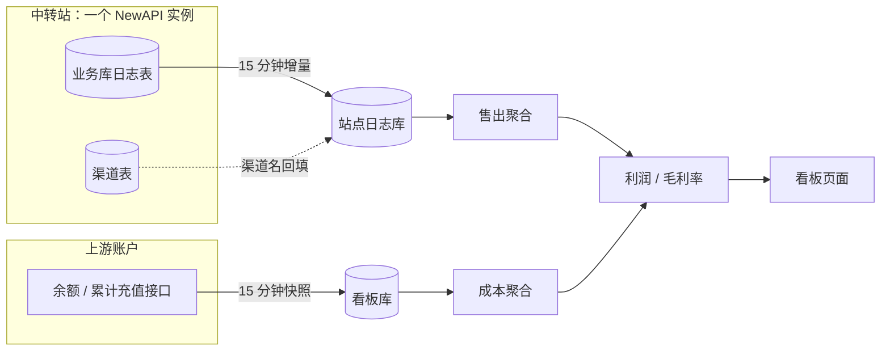

# relay-ledger

只读的 NewAPI 中转站经营看板：从站点日志算出售出，从上游账户余额算成本，得到每个上游账户的利润与毛利率。


- [简介](#简介)
- [特性](#特性)
- [快速开始](#快速开始)
- [使用](#使用)
- [配置](#配置)
- [架构](#架构)
- [API](#api)
- [常见问题](#常见问题)
- [许可证](#许可证)
- [致谢](#致谢)

## 简介

这是一个给**自建 NewAPI 中转站**用的经营看板。它把两件本来分开的事放进同一个账面：中转站自己卖出去多少（站点日志里的 `cost`），以及你从上游买额度实际扣了多少（上游账户的余额快照与累计充值）。两者相减就是利润，除以售出就是毛利率。看板只读——不写中转站业务库、不改渠道状态、不动上游配置，所有算不出来的数字一律显示 `—`，不用 0 或插值凑数。

## 特性

- 售出直读明细：按 `log_type = 2` 且排除 `Model test` 现算 `SUM(cost)`，不采信上游预聚合表（它按渠道合并、重启会丢数据）。
- 成本按余额闭环：`成本 = 期初余额 + 期间充值 − 期末余额`，余额每 15 分钟落一次快照。
- 充值取累计计数器：NewAPI 用 `quota + used_quota`、Sub2API 用 `total_recharged` 的区间差值，与消耗无关，不会把「充值 5 消耗 2.5」算成成本 0。
- 缺失即缺失：没有快照、没有日志、算出负成本时返回空值并标注原因，界面显示 `—`，不补零、不插值、不借相邻小时。
- 覆盖度可见：上游账户与渠道行标出「完整 / 部分 / 缺快照 / 无成本源」，区间合计只要缺一个桶就不求和，同时给出 `11/24` 这类覆盖度。
- 前端使用 React、shadcn/ui、Tailwind CSS 与 Recharts，由 Vite 构建；后端使用 Node 内置 `node:sqlite`。
- 部署简单：一个看板进程、一个采集进程、一个登录进程，配 `instance.json` 与 `accounts.json` 两份配置即可。

## 快速开始

### 环境要求

- Node.js **≥ 22.13**（`node:sqlite` 从该版本起可用且不再需要 `--experimental-sqlite`）。
- 构建前端需要 npm；按 `frontend/package-lock.json` 安装依赖，构建产物为 `frontend/dist/`。
- 接入真实数据时另需其一：与 NewAPI 同机的 `one-api.db` 读权限，或一个中转站管理员令牌（PAT）。

### 安装

```bash
cd relay-ledger
node --version    # 应不低于 v22.13.0
npm --prefix frontend ci
npm --prefix frontend run build
```

### 运行

```bash
cp instance.example.json instance.json
node v2/server.mjs --port=8788
```

打开 <http://127.0.0.1:8788/>，根路径提供新版前端，站点名称从 `/api/meta` 的实例配置读取。日志副本库缺失且没有可回退的业务库时，服务会创建空副本库并提示；未采集的成本与比率显示 `—`，`/api/healthz` 返回 `{"ok":true}`；按「基础用法」接入数据。缺少 `frontend/dist/index.html` 时页面会明确提示先构建。看板只监听 `127.0.0.1`，对外访问请按 [部署指南](docs/DEPLOY.md) 在 nginx 后面加登录。

`frontend/dist/` 已被 gitignore，不提交版本库；发布时应从同一代码版本构建并携带产物，同时保留运行必需的 `shared/settings-defaults.json`。旧静态源码暂时保留，默认入口使用新版。开发代理与本地预览见 [前端说明](frontend/README.md)。

### 跑测试

```bash
node --test v2/test/*.test.mjs
npm --prefix frontend run typecheck
npm --prefix frontend run lint
npm --prefix frontend test
npm --prefix frontend run build
```

后端测试必须带 glob：`node --test v2/test` 会把目录当文件读而报错；测试使用临时库与注入 fetch，不连真实站点、不写生产数据。

## 使用

### 三个概念

- **中转站（site）**：你部署的这个 NewAPI 实例，由 `instance.json` 的 `site` 段描述（历史命名，配置里仍叫 `site`）。一个看板进程只服务一个中转站。
- **上游账户（upstream account）**：你在别处买额度的来源，写在 `accounts.json` 的 `accounts[]` 里；一个账户可以挂多个渠道，共用同一份余额池。`/api/profit` 返回的 `sites[]` 就是这些上游账户，历史命名沿用 `sites`。
- **渠道（channel）**：NewAPI 的 channel。售出按渠道统计，再按渠道 `base_url` 的主机归属到上游账户；渠道到账户的映射是人工配置的 `channels: [13, 15, ...]`。

售出发生在渠道层，充值与余额发生在账户层，两者只在账户层对齐。渠道级不分摊成本（[D8](docs/DECISIONS.md)），这是账面能自洽的前提。

### 基础用法

```bash
# 常驻采集：余额与站点日志各 15 分钟一轮
node v2/jobs/run-scheduler.mjs

# 面板
node v2/server.mjs --port=8788
```

接上真实数据分三步：

1. **配 `instance.json`**：从 `instance.example.json` 复制，填中转站标识、中转站地址、日志接口路径、数据目录，以及中转站业务库路径（`source: "db"`）或管理员令牌路径（`source: "http"`）。
2. **写 `accounts.json` 并映射渠道**：按 [上游账户配置](docs/UPSTREAM.md) 补账户、凭据与 `channels`。没有映射的渠道会在「未映射」里单列，不会被丢掉。
3. **起采集与面板**：先前台跑 `node v2/jobs/run-scheduler.mjs --once` 验证凭据和源库，再交给 systemd 常驻（模板见 `v2/deploy/`）。

### 进阶用法

- **采集参数**：`run-scheduler.mjs --once`（各跑一次后退出，退出码 0/1）、`--no-logs`（关闭站点日志采集）、`--spend-interval-ms=<n>`、`--logs-interval-ms=<n>`、`--no-prune`（不跑每日清理）、`--no-http-errors`（关闭 nginx 错误码聚合）。错误码聚合默认读取 `/var/log/nginx/access.log`，运行用户须有文件读权限与父目录遍历权限，日志轮转后也需保持；不接入时用 `--no-http-errors`。
- **日志采集参数**：`collect-site-logs.mjs --source=db|http`、`--db-file=<path>`、`--days=<n>`（空库回看天数）、`--chunk-days=<n>`（HTTP 分片长度）、`--timeout-ms=<n>`、`--since=<ISO8601>`（指定回补起点）、`--dry-run`（只读不写）。
- **面板参数**：`server.mjs --port=<n>`、`--host=<addr>`；端口也可用环境变量 `PORT`，主机用 `HOST`。
- **登录服务**：`panel-auth.mjs --port=8790`，密码与会话密钥用 `PANEL_PASSWORD_FILE`、`PANEL_SESSION_SECRET_FILE` 指向文件。
- **维护任务**：`prune-logs.mjs --dry-run`（预估清理量）、`rollup-logs.mjs --keep-days=90`（归档 90 天前明细），两者都由常驻采集每天自动跑一次。
- **生产部署**：systemd 单元、nginx 与登录接线、cron 备选，见 [docs/DEPLOY.md](docs/DEPLOY.md)。

## 配置

### instance.json

放在仓库根（已 gitignore），从 `instance.example.json` 复制。

```json
{
  "site": {
    "id": "relay",
    "name": "My Relay",
    "base_url": "https://relay.example.com",
    "log_path": "/api/log"
  },
  "paths": {
    "data_dir": "./data",
    "relay_db": "/home/newapi/one-api.db",
    "site_token": "",
    "accounts": ""
  },
  "collect": {
    "source": "db",
    "spend_interval_ms": 900000,
    "logs_interval_ms": 900000
  }
}
```

| 字段 | 含义 |
| --- | --- |
| `site.id` | 中转站标识，同时是日志库文件名：`<dataDir>/db/sites/<site.id>.db` |
| `site.name` | 中转站显示名 |
| `site.base_url` | 中转站地址，HTTP 采集与页面展示使用 |
| `site.log_path` | 站点日志接口路径，HTTP 采集使用 |
| `paths.data_dir` | 运行时数据根目录 |
| `paths.relay_db` | NewAPI 业务库（`one-api.db`）路径，仅 `source: "db"` 用 |
| `paths.site_token` | 管理员 PAT 文件路径，仅 `source: "http"` 用 |
| `paths.accounts` | 上游账户配置路径，留空取 `<dataDir>/accounts.json` |
| `collect.source` | `db` 直读业务库，`http` 走管理员导出接口 |
| `collect.spend_interval_ms` | 余额采集间隔（毫秒） |
| `collect.logs_interval_ms` | 站点日志采集间隔（毫秒） |

- 配置定位顺序：`--config=<path>` → 环境变量 `RELAY_LEDGER_INSTANCE` → 仓库根 `instance.json`；三者都缺失时用内置默认值正常启动。
- `paths.*` 的相对路径相对于 `instance.json` 所在目录，不是当前工作目录。
- 数据目录布局：

```text
<dataDir>/
├── db/sites/<site.id>.db   中转站日志库（售出）
├── dashboard.db            余额快照、充值事件、任务记录、日归档
├── accounts.json           上游账户与渠道映射（可用 paths.accounts 改）
└── <token 文件>            管理员 PAT（paths.site_token，仅 http 源需要）
```

令牌文件支持两种写法：单行纯 token；或多行 `名称：token`（全角冒号），按 `site.id` 取对应行。

### accounts.json

上游账户、凭据与渠道映射写在这里，字段、三种账户类型与最小示例见 [docs/UPSTREAM.md](docs/UPSTREAM.md)。文件权限应为 `0600`，只放服务器，永不入仓库。

### 环境变量

| 变量 | 作用 |
| --- | --- |
| `RELAY_LEDGER_INSTANCE` | 指定 `instance.json` 路径（systemd 与 cron 用它） |
| `PORT` / `HOST` | 面板监听端口与地址，`--port` / `--host` 优先 |
| `PANEL_PASSWORD_FILE` / `PANEL_SESSION_SECRET_FILE` | 登录服务的密码文件与会话签名密钥文件 |
| `API_CACHE_TTL_MS` | 面板业务 API 进程内缓存时长（毫秒，默认 60000，`0` 关闭） |
| `WARMUP=0` | 关闭面板启动时的首屏预热查询 |

### 凭据与隐私

仓库不含任何凭据或真实数据。运行时生成或需要人工放置的文件都在 `.gitignore` 里：`instance.json`、数据目录 `data/`、上游账户目录 `v2/secrets/`、中转站令牌目录 `meta/`，以及 `db/sites/*.db`、`v2/db/*.db` 这些运行时库。上游账户文件权限 `0600`，只放服务器；本地配置绝不整文件覆盖生产环境（[D13](docs/DECISIONS.md)）。

## 架构

### 文件结构

```text
relay-ledger/
├── frontend/              React / TypeScript 前端，Vite 构建到 dist/（gitignore）
├── shared/                前后端共享默认设置，运行时必须保留
├── v2/
│   ├── server.mjs         面板 HTTP 服务（JSON API + 静态页）
│   ├── lib/               查询聚合、账本计算、实例配置、北京时间分桶
│   ├── store/             站点日志库与看板库的读写
│   ├── jobs/              采集任务、常驻调度、保留期清理与归档
│   ├── sources/upstream/  上游适配（NewAPI / Sub2API / 渠道 key）
│   ├── web/               暂保留的旧静态源码，非默认发布入口
│   ├── tools/             面板登录服务、浏览器采集导入
│   ├── deploy/            systemd / nginx / cron 模板
│   └── test/              node:test 用例
├── docs/                  设计、口径、决策、部署、上游配置
├── web/vendor/            旧页面图表依赖（暂保留）
├── data/                  运行时数据（gitignore）
└── instance.example.json  实例配置模板
```

### 架构图



采集与展示是两条独立链路：售出可以事后回补（日志还在），成本不能回补（余额只有当下）。后端使用 Node 内置 `node:http` + `node:sqlite`，同源提供 JSON API 与 `frontend/dist/`；前端使用 React / TypeScript / Vite，开发与预览通过 `/api` 代理连接后端。

## API

| 方法 | 路径 | 说明 |
| --- | --- | --- |
| GET | `/api/meta` | 中转站、源库路径、日志时间范围与行数 |
| GET | `/api/overview?from=&to=` | 收入、配额、请求、token、缓存率、延迟、成本与毛利 |
| GET | `/api/trend?granularity=day`（或 `hour`） | 按北京时间的收入 / 请求趋势 |
| GET | `/api/profit?from=&to=&granularity=day`（或 `hour`） | 账户盈利、渠道售出、未映射渠道与数据质量 |
| GET | `/api/channels?from=&to=` | 渠道聚合：售出、token、TPS、缓存率、延迟分位、归属 |
| GET | `/api/groups?from=&to=` | 分组聚合：渠道数、售出、token、请求 |
| GET | `/api/upstreams?from=&to=` | 账户级账本：期初 / 期末余额、充值、成本、毛利 |
| GET | `/api/quality` | 采集失败、任务记录、缺快照账户、未映射渠道 |
| GET | `/api/rows?from=&to=&page=&page_size=` | 逐条明细，`page_size` 上限 200 |
| GET | `/api/healthz` | 存活检查，返回 `{"ok":true}` |

时间参数为毫秒时间戳，缺省走默认区间（最近 7 个北京自然日）；错误统一为 `{"error":{"code":"...","message":"..."}}`。

完整的 19 个接口路径、参数与缓存规则见 [接口契约](v2/CONTRACT.md)，包括用户、模型、资金、错误、健康状态、路由、运行时设置、服务状态与站点图标。

**术语**：`site` 是历史命名——`instance.json` 的 `site`、`db/sites/<site.id>.db`、`/api/meta` 里的 `site` 都指你部署的这个中转站；`/api/profit` 返回的 `sites[]` 是上游账户，不是中转站。

```bash
curl -s "http://127.0.0.1:8788/api/healthz"
curl -s "http://127.0.0.1:8788/api/profit?granularity=day"
```

## 常见问题

**所有成本都显示 `—`。** 成本需要同一时间桶的期初与期末各一个余额快照，且快照与桶边界的偏差不超过 5 分钟。刚部署时至少攒满一个整点小时才有第一个可用桶；`/api/quality` 的 `jobs` 与 `collect_errors` 能看到采集是否在跑、哪个账户失败。

**渠道名字为空。** 源库 `logs.channel_name` 允许为 NULL，采集器会用 `channels.name` 回填。回填后仍为空，说明该渠道已从 `channels` 表删除，只剩历史日志。

**页面提示前端尚未构建。** 在仓库根执行 `npm --prefix frontend ci` 与 `npm --prefix frontend run build`，并确认服务部署目录含同版本的 `frontend/dist/`。首访缓慢时检查 nginx 压缩、静态资源请求与后端查询耗时；资源体积以当次构建输出为准。

**登录后立刻被打回登录页。** `auth_request` 子请求不会继承原请求的 Cookie，nginx 的 `/verify` 必须显式写 `proxy_set_header Cookie $http_cookie;`，模板已包含。

**成本是负数或整段为空。** 管理员手工改过余额、或漏采超过 5 分钟，口径会判为「无法核算」并显示 `—`，这是设计行为，不是故障。

### 已知限制

- 上游余额没有历史接口，小时级成本只能从部署那一刻开始积累，无法回补。
- 中转站日志保留期由中转站决定，本地必须自留副本；90 天前的明细归档为日粒度后，不再有小时趋势与延迟分位。
- 渠道级不做充值分摊，渠道表只有售出，没有成本与毛利；成本与毛利只在账户层成立。
- 包月订阅型上游（无独立余额账户）标为「无成本源」，只统计售出。

## 许可证

本项目采用 MIT 许可证，全文见仓库根目录的 [LICENSE](LICENSE)。

## 致谢

- 借鉴 [New API](https://github.com/QuantumNous/new-api) 与 [one-api](https://github.com/songquanpeng/one-api) 的日志与渠道数据结构，售出口径与它们保持一致。
- 新版前端使用 [React](https://react.dev/)、[shadcn/ui](https://ui.shadcn.com/)、[Base UI](https://base-ui.com/)、[Tailwind CSS](https://tailwindcss.com/)、[Recharts](https://recharts.org/) 与 [Vite](https://vite.dev/)（均为 MIT）；图标使用 [Lucide](https://lucide.dev/)（ISC），字体通过 Fontsource 随构建分发，保留其各自许可证。暂保留的旧页面使用 Apache ECharts（Apache-2.0）与 Tabler（MIT）。
- 感谢所有提交问题、提供真实运行数据用于核对口径的贡献者。
