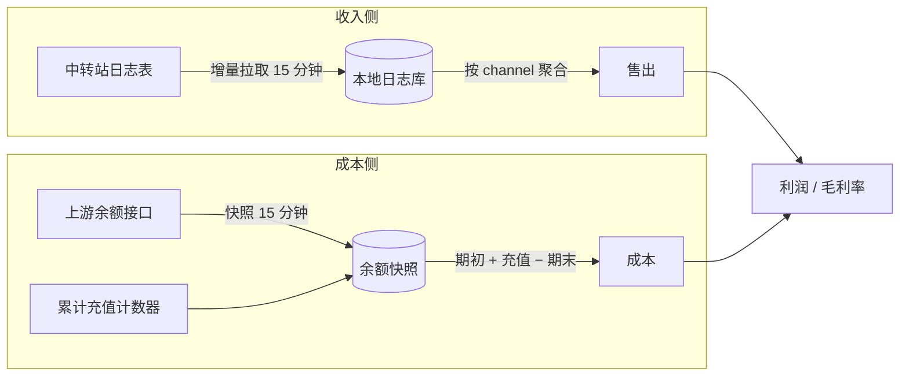

# 设计说明

> 本文写「为什么这样设计」和「不能违反的约束」。
> 接口字段、表结构、部署命令属于实现层，见 `v2/README.md` 与 `v2/CONTRACT.md`。
> 数字口径见 `docs/METRICS.md`，历史取舍见 `docs/DECISIONS.md`。

## 1. 项目定位

把中转站的**收入**和**上游成本**放进同一个账面，回答三个问题：

1. 这段时间卖了多少？
2. 上游实际扣了多少？
3. 中间差多少、毛利率多少？

以及一个隐性问题：**这些数字现在可信吗？**

它不是什么：

- 不是计费系统——不产生账单、不参与扣费。
- 不是风控或审计系统——不做限流判定、不查异常调用。
- 不是上游管理后台——不改上游配置、不改渠道状态。

一句话：**只读的核算看板**。任何让看板去写业务库、去改上游状态的实现，都是越界。

## 2. 名词与单位

| 名词 | 含义 | 要点 |
| --- | --- | --- |
| 中转站（`site`） | 你部署的这个 NewAPI 实例 | 售出发生在这里；看板只读它 |
| 上游账户（`sites[]`，历史命名） | 被核算的每个上游站点账户 | 核算的最小单位，充值、成本、毛利都记在这一层 |
| 渠道 | 中转站的一条转发线路 | 有独立的 base_url，按主机归到上游账户 |
| 分组 | 渠道的逻辑分组 | 只用于经营分析，不参与成本 |
| 时间桶 | 日桶或小时桶 | 北京时间，左闭右开 |
| 余额快照 | 某一刻上游账户的余额 | 上游余额没有历史接口，只能周期性抓取 |
| 累计充值计数器 | 上游自己记的「累计获得额度」 | 与消耗无关，是充值的首选来源 |

`site` 是历史命名：`instance.json` 的 `site`、`db/sites/<site.id>.db`、`/api/meta` 的 `site` 都指你部署的这个中转站；`/api/profit` 返回的 `sites[]` 是上游账户，不是中转站。

核心不对称：**充值发生在账户层，售出发生在渠道层**。两者只有在这一层能对齐，往下拆（渠道级充值）只能是估算，见 `DECISIONS.md` D9。

## 3. 两条数据链路

两条链路完全独立，只在最终聚合时相遇。这带来一个必须接受的事实：

- **售出可以事后回补**（日志还在，能重算）。
- **成本不能回补**（余额只有当下，没抓就是没有）。

所以历史区间出现「有售出、无成本」是正常状态，不是 bug。见 `METRICS.md` 第 7 节。

## 3.1 功能视图与职责

每个视图只回答一个问题。口径解释不堆在页面上——页面以数字和图表为主，口径进本文与 `METRICS.md`。

| 视图 | 回答的问题 | 必须区分 |
| --- | --- | --- |
| 顶部时间轴 | 我在看哪一段？ | 「数据截止」（最后一条业务数据）与「上次采集」（管道最后一次成功）必须分开显示 |
| KPI 卡 | 这段区间总量是多少？ | 环比只在有可比数据时显示，否则留空 |
| 收入与请求趋势 | 卖给了谁、什么时候卖的？ | 售出按上游账户堆叠；请求量单独一条线，不混进金额轴 |
| 站点盈利 | 每个上游账户赚了多少？ | 售出、充值、成本、利润、毛利率、状态、覆盖度 |
| 渠道经营表现 | 具体哪条线路在卖？ | 售出、token、TPS、缓存率、延迟分位、额度/亿 token |
| 分组经营表现 | 同一类渠道整体如何？ | 与渠道视图同构，但用「渠道数」替代上游账户 |
| 上游账户与核算 | 每个账户此刻还剩多少？ | 余额、充值、上报消费、推导消费、账户与渠道状态 |
| 数据质量 | 这些数字现在可信吗？ | 采集失败、任务记录、缺快照账户、未映射渠道 |

三条展示约束：

1. **金额列不带单位后缀。** 单位在表头或卡片标题说明一次即可。
2. **空值显示 `—`，不显示 `$0.00`。** 见第 6 节。
3. **列可配置，但名称列不可隐藏。** 每张明细表允许用户选列，选择按表独立保存。

渠道明细与分组明细不再按经营/性能/全部拆表：两页各自只有一张统一表，列可配置且按页独立保存；每页表格下方固定一张对应维度的健康卡（渠道页为渠道级、分组页为分组级）。独立「渠道健康」页继续保留，用于跨渠道/分组集中查看。

侧栏按业务域分三组：经营分析（总览、盈利、排行、模型经营）、运营与资产（渠道明细、分组明细、上游账户、资金与续航）、系统与运维（渠道健康、数据质量、系统状态）；设置独立置底，与三组平级。四个补充视图的职责：

- **模型经营**：按模型看售出、请求数、token、每亿 token 均价与上游归属，回答「哪个模型在卖、单位经济性如何」；只读分析，不提供模型配置或路由修改。
- **资金与续航**：按上游账户看余额、7 日均成本与可支撑天数，回答「按当前消耗还能撑多久」；续航是估算，必须与余额快照时间和成本窗口一起读。
- **渠道健康**：按渠道/分组看 24 小时（15 分钟格）或 7 天（1 小时格）的成功率与错误分布，回答「哪条线路在坏」；样本不足只标未知，不下结论。
- **系统状态**：看后端进程探测、API 职责清单与 Nginx 入口 HTTP 错误分布，回答「看板服务是否可达、入口有哪些错误」；进程探测不代表各接口已独立通过检查，采集任务仍归数据质量页。
- **渠道路由**：按渠道看配置侧事实——启用状态、入口地址、上游账户归属、分组×模型可达关系（abilities），回答「这条线路配了什么、哪些分组模型能走」。只读源库配置，不读日志、不补边、不改归属；`model_mapping` 仅作附注，不生成路由边。

渠道路由的数据来自源库 `channels` + `abilities` 的同一次一致读，落在看板库单行快照；同步失败保留旧快照并显示错误与尝试时间，缺 `abilities` 表时明确标「路由不可用」而不是空成功；从未采集、采集到空配置是两种状态。快照只含安全字段（渠道名、状态、base_url、model_mapping 与 abilities），不复制任何 key、cookie 或账户凭据；账户归属来自静态账户配置，停用账户与多账户共享都按原样展示。

## 4. 系统边界

**可以读**：中转站业务库（只读打开）、上游余额与充值接口、自己的看板库。

**可以写**：自己的看板库（快照、事件、任务记录、归档表）、本地日志副本。

**不得写**：中转站业务库、上游任何配置、任何渠道状态。日志副本即使物理上可写，也只允许追加本站日志，不允许修改历史行。

**不得依赖**：上游的聚合表（如看板的预聚合表）。它由内存缓存定时刷盘，会因重启丢数据、因取整而偏移；核算必须直读明细。见 `DECISIONS.md` D3。

**实例配置**：中转站身份与路径不写进代码，统一由仓库根的 `instance.json` 提供（已 gitignore，从 `instance.example.json` 复制）。定位顺序为 `--config=<path>` → 环境变量 `RELAY_LEDGER_INSTANCE` → 仓库根 `instance.json`，三者都缺失时用内置默认值启动；`paths.*` 的相对路径相对于 `instance.json` 所在目录。一个进程只服务 `site.base_url` 指向的那一个 NewAPI 实例，数据落 `<dataDir>/db/sites/<site.id>.db` 与 `<dataDir>/dashboard.db`。字段与部署见 `docs/DEPLOY.md`。

## 5. 核心不变量

这些是系统正确性的定义，实现可以换，不变量不能破：

1. **一个渠道只能属于一个上游账户。** 共享渠道不做收入拆分，必须在数据里显式标为「未分配」，不能按比例硬分。
2. **停用账户仍然参与归属。** 账户停用不等于它的渠道停止销售；归属按渠道走，不按账户开关走。
3. **售出与成本必须落在同一个时间桶口径上。** 任一侧粒度更粗，毛利率就会失真。
4. **缺失就是缺失。** 没有快照、没有日志、没有充值记录，一律返回空值并标注原因，不返回 0，不插值，不借相邻数据。
5. **成本为负等于口径失效。** 余额被管理员手工调整会表现为负成本，此时必须判为「无法核算」，而不是给一个负毛利。
6. **采集失败必须可见。** 不允许静默降级成「一切正常」；余额成功但入账缺失属于「部分可用」，不算失败。
7. **凭据只存在于配置目录，永不进入仓库、日志、错误信息、接口响应。**

## 6. 缺失与失败的呈现

界面上只有四种状态，语义固定：

| 状态 | 含义 | 界面表现 |
| --- | --- | --- |
| 完整 | 该区间每一桶都算得出成本 | 正常显示数字 |
| 部分 | 部分桶缺失，或充值来源不全 | 显示数字 + 覆盖度（如 11/24） |
| 缺快照 | 一个桶都算不出 | 显示 `—` + 原因 |
| 无成本源 | 该渠道没有上游账户（只卖不算成本） | 显示售出，成本列 `—` |

两条硬规则：

- **`—` 不等于 0。** 任何「没查到」都只能显示 `—`。
- **区间合计不部分求和。** 上游账户级合计只要有一个桶缺失就为 `—`，同时给出覆盖度说明缺几个桶。理由：把「有成本的桶」和「有售出的桶」拼在一起相加，会得到一个看起来正常、实际无意义的毛利率。

## 7. 与实现的关系

- 本文与 `METRICS.md` 是**契约层**：改动这里需要明确说明原因。
- `v2/README.md` 是**实现层**：可以随代码演进。
- `v2/CONTRACT.md` 是**接口层**：字段语义变更必须同步。
- 测试是这套口径的执行体：**改口径必须同时改测试**，只改代码不改测试视为回归。

## 8. 演进约束

以下三条在重构、换框架、换数据库时都必须保持：

1. **口径不随实现变化。** 换前端、换构建方式、换存储，数字必须逐位一致。
2. **历史数据不重算。** 已落库的快照与事件是事实，不允许为了「看起来更整齐」去回填或修正。
3. **降级优先于报错，但降级必须留痕。** 单个上游账户采集失败不应让整页失效，但必须在质量区可见。
