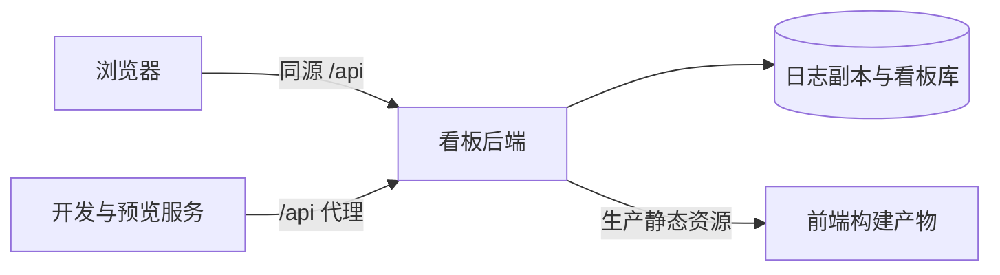

# relay-ledger 前端


## 简介

NewAPI 中转站经营看板的 React 前端，通过同源 `/api` 读取 `v2` 后端的经营与采集数据；生产入口为站点根路径 `/`。

## 特性

- React / TypeScript 页面，使用 shadcn/ui、Tailwind CSS 与 Recharts。
- 站点名称与地址来自 `/api/meta`，缺失指标显示 `—`。
- 展示偏好保存在浏览器，服务端阈值与采集设置通过 `/api/settings` 管理。

## 快速开始

### 环境要求

- Node.js ≥ 22.13 与 npm，前后端使用同一仓库版本。
- 以下命令均在仓库根目录执行。

### 安装

```bash
npm --prefix frontend ci
npm --prefix frontend run build
```

### 运行

```bash
node v2/server.mjs --host=127.0.0.1 --port=8788
```

打开 <http://127.0.0.1:8788/>。后端提供 `frontend/dist/` 与 `/api`；空日志库可以启动，真实数据接入见 [根 README](../README.md#使用)。

## 使用

### 本地开发

保持后端在 `127.0.0.1:8788` 运行，另开终端：

```bash
npm --prefix frontend run dev
```

打开 Vite 输出的地址。`dev` 与 `preview` 均把 `/api` 代理至 `http://127.0.0.1:8788`，浏览器只向当前页面的源发请求。代理保留写设置所需的同源关系，后端不开放 CORS。

### 检查与预览

```bash
npm --prefix frontend run typecheck
npm --prefix frontend run lint
npm --prefix frontend test
npm --prefix frontend run build
npm --prefix frontend run preview
```

`preview` 用于本地检查已构建产物，仍需后端运行；生产部署由 `v2/server.mjs` 提供静态文件，步骤见 [部署指南](../docs/DEPLOY.md)。

## 配置

- `vite.config.ts` 的 `base` 为 `/`，资源路径为 `/assets/...`；当前发布入口使用站点根路径。
- 站点显示名来自 `instance.json` 的 `site.name`，经 `/api/meta` 下发。
- `shared/settings-defaults.json` 是前后端共享默认值，构建与后端运行均需保留；字段与校验见 [运行时设置](../docs/SETTINGS.md)。
- 生产配置、凭据与数据沿用后端部署策略，不写入前端源码或构建产物。

## 架构

```text
relay-ledger/
├── frontend/
│   ├── src/components/    看板视图与界面组件
│   ├── src/lib/           API、格式化、时间区间与设置
│   ├── vite.config.ts     根路径与开发 / 预览代理
│   ├── package-lock.json  锁定构建依赖
│   └── dist/              构建产物（gitignore）
└── shared/                共享默认设置，构建与后端运行必需
```



技术栈为 React / TypeScript / Vite / Tailwind CSS / shadcn/ui / Recharts。构建产物不提交版本库，发布时须与后端代码版本一致；资源体积以当次构建输出为准。

## API

接口索引、时间范围、缓存与错误语义见 [v2/CONTRACT.md](../v2/CONTRACT.md)，响应字段说明见 [v2/README.md](../v2/README.md#api)。站点图标通过同源 `/api/site-logo` 获取，安全抓取规则见 [站点图标](../docs/SITE-LOGOS.md)。

## 常见问题

- 页面提示未构建：先执行 `ci` 与 `build`，部署时带上 `frontend/dist/`。
- 开发或预览 API 失败：确认 `v2/server.mjs` 已监听 `127.0.0.1:8788`。
- 设置保存返回 403：检查浏览器是否通过当前页面的 `/api` 访问，并核对反向代理的 Host、端口与协议转发，见 [设置说明](../docs/SETTINGS.md#反向代理与端口)。

## 许可证

沿用仓库 [MIT 许可证](../LICENSE)，第三方组件与字体保留各自许可证。

## 致谢

- 参考 [New API](https://github.com/QuantumNous/new-api) 的中转站日志与渠道数据结构。
- 使用 React、shadcn/ui、Base UI、Tailwind CSS、Recharts、Vite（MIT）、Lucide（ISC）及 Fontsource 分发的字体。
- 感谢提供问题反馈与口径核对数据的贡献者。
